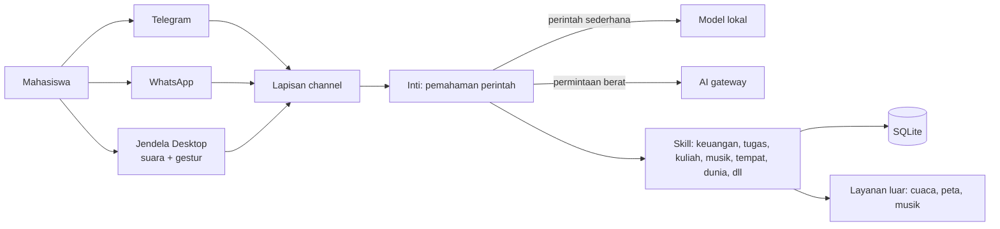

# Campus Jarvis

Asisten AI pribadi untuk mahasiswa. Bisa diajak ngobrol lewat Telegram, WhatsApp, atau jendela desktop dengan suara, untuk mengurus uang saku, tugas, jadwal kuliah, dan pengingat, tanpa harus buka banyak aplikasi.

> Repo ini versi portofolio: isinya penjelasan, arsitektur, dan studi kasus. Kode inti disimpan di repo private.

<!-- TODO: ganti dengan GIF demo (rekaman desktop + chat Telegram), simpan sebagai assets/demo.gif -->

## Masalah yang dipecahin

Dari survei dan obrolan dengan mahasiswa, keluhannya mirip-mirip:
- Info tugas tersebar di grup chat, e-learning, dan pesan dosen, jadi gampang kelewat.
- Deadline dan jadwal kuliah dicatat di banyak tempat, atau cuma diingat-ingat.
- Uang saku habis tanpa tahu larinya ke mana.
- Aplikasi produktivitas yang ada ribet di-setup dan akhirnya ditinggal.

Campus Jarvis mengumpulkan semuanya di satu tempat yang dipakai lewat chat biasa, dengan kalimat bebas seperti "catat makan siang 15 ribu" atau "besok ada tugas apa?".

## Fitur utama

- **Keuangan:** catat pemasukan dan pengeluaran, saldo, ringkasan dengan grafik animasi.
- **Tugas dan kuliah:** daftar mata kuliah, tugas per matkul, jadwal, pengingat otomatis (termasuk H-1).
- **Ibadah dan kegiatan harian:** pengingat salat dan rutinitas.
- **Paham kalimat bebas:** tidak perlu hafal perintah. Ada jalur cepat berbasis kata kunci sebagai cadangan.
- **Personalisasi:** panggilan, gaya bicara (beberapa persona), suara, dan seberapa banyak balasan dibacakan.
- **Mode desktop (Windows):** kontrol suara untuk buka aplikasi, putar musik, atur volume dan kecerahan, pencarian tempat terdekat, dan pantauan kondisi dunia (cuaca, kualitas udara, gempa, pasar, berita) yang dinarasikan seperti penyiar.
- **Kontrol gestur tangan lewat kamera** dan tampilan partikel 3D di versi desktop.

<!-- TODO: tambah 3 sampai 4 screenshot di assets/ lalu tampilkan di sini -->
| Telegram | Desktop | Ringkasan keuangan |
|---|---|---|
|  |  |  |

## Arsitektur singkat

<!-- TODO: kalau mau, ekspor diagram ini jadi gambar rapi dan simpan di assets/arsitektur.png -->

Intinya ada empat lapisan:
1. **Channel:** pintu masuk (Telegram, WhatsApp, desktop). Semuanya diseragamkan jadi satu format pesan.
2. **Inti:** memahami maksud pesan. Perintah sederhana dilayani cepat oleh jalur lokal, hanya permintaan yang butuh penalaran yang dikirim ke AI lewat gateway.
3. **Skill:** modul per fitur (keuangan, tugas, kuliah, pengingat, musik, tempat, kondisi dunia). Gampang ditambah tanpa mengubah inti.
4. **Penyimpanan:** SQLite lokal, data pribadi tidak dikirim ke mana-mana selain yang dibutuhkan untuk menjawab.

Penjelasan lebih rinci ada di [docs/arsitektur.md](docs/arsitektur.md).

## Teknologi

- Python (bot dan backend), SQLite
- python-telegram-bot untuk Telegram
- WhatsApp: jembatan Node (Baileys) untuk prototipe, WhatsApp Business Platform untuk jalur resmi
- AI lewat gateway kompatibel OpenAI, plus model lokal lewat Ollama untuk perintah ringan
- Suara: ElevenLabs dan Edge TTS (bicara), pengenalan suara di browser/desktop
- Desktop: jendela berbasis web, MediaPipe untuk gestur tangan dan segmentasi latar
- Data pendukung: Open-Meteo, USGS/BMKG, NASA FIRMS, Google Maps lewat Serper, Spotify

## Cara kerja singkat

1. Mahasiswa mengirim pesan, misalnya "ingetin tugas statistik besok jam 8".
2. Channel meneruskan pesan ke inti.
3. Inti memilih jalur: skill yang cocok langsung dijalankan, atau AI diminta menafsirkan maksudnya lebih dulu.
4. Skill menyimpan atau mengambil data, lalu menyusun balasan.
5. Balasan dikirim lewat channel yang sama, dan di desktop bisa dibacakan dengan suara.

## Konsep dan model bisnis (versi ringan)

Campus Jarvis dirancang sebagai **jasa setup dan personalisasi asisten AI** untuk mahasiswa, bukan sekadar aplikasi.
- **Paket Simple:** lewat Telegram dan WhatsApp, cocok untuk perangkat apa saja.
- **Paket Advance:** jalan di laptop sendiri, dengan fitur desktop yang lebih lengkap.
- **Alur layanan:** setup awal, lalu pendampingan lewat konsultasi online atau tatap muka.
- **Target awal:** mahasiswa di lingkungan kampus sendiri, lalu berkembang dari mulut ke mulut.

Studi kasus lengkapnya ada di [docs/studi-kasus.md](docs/studi-kasus.md).

## Status

Prototipe sudah berjalan dan didemokan ke pengguna nyata. Beberapa hal masih tahap pengembangan: versi Android, hosting 24 jam, dan pembayaran online.

## Catatan

Kode inti, prompt kepribadian, dan konfigurasi tidak disertakan di repo ini. Kalau tertarik berdiskusi atau lihat demo langsung, hubungi lewat profil GitHub.
