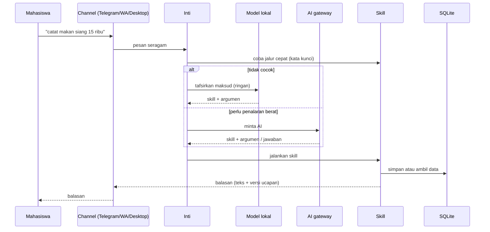

# Arsitektur Campus Jarvis

Dokumen ini menjelaskan susunan sistemnya di level konsep. Detail implementasi sengaja tidak dibuka.

## Gambaran besar

<!-- TODO: tambah gambar arsitektur versi rapi di assets/ kalau perlu -->

## Prinsip desain

- **Cepat dulu, pintar kemudian.** Perintah umum dilayani jalur cepat tanpa menunggu AI. AI dipakai saat memang dibutuhkan.
- **Satu otak, banyak pintu.** Telegram, WhatsApp, dan desktop berbagi logika yang sama, jadi fitur baru langsung tersedia di semua channel.
- **Skill modular.** Tiap fitur adalah modul sendiri dengan daftar alat dan jalur cepatnya.
- **Teks layar dan teks ucapan dipisah.** Yang tampil ringkas dan rapi, yang diucapkan ditulis supaya enak didengar.
- **Data pribadi tetap lokal.** Database ada di perangkat pengguna.
- **Gagal dengan sopan.** Kalau internet atau layanan luar bermasalah, ada cadangan atau pesan yang jelas.

## Lapisan

| Lapisan | Tugas |
|---|---|
| Channel | Menerima dan mengirim pesan, tombol, gambar, dan suara untuk tiap platform |
| Inti | Memilih jalur, menjaga ingatan percakapan singkat, mengatur persona dan gaya bicara |
| Skill | Menjalankan fitur: keuangan, tugas, kuliah, pengingat, musik, tempat, kondisi dunia |
| Penyimpanan | Data pengguna, pengaturan, dan pengingat |

## Rencana pengembangan

- Hosting bot agar aktif 24 jam tanpa laptop menyala
- Versi Android mandiri dengan pengingat sebagai fitur utama
- Tautan akun Telegram dan WhatsApp lewat kode verifikasi
